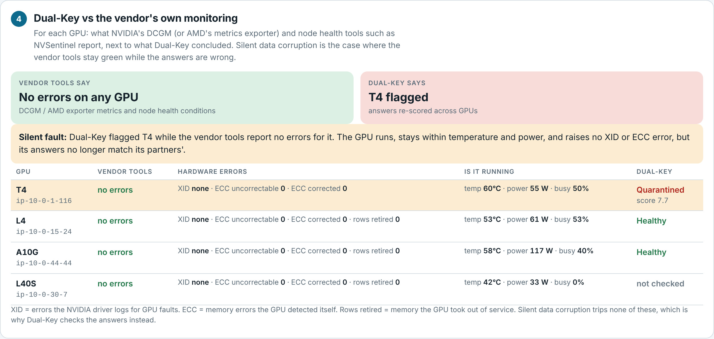
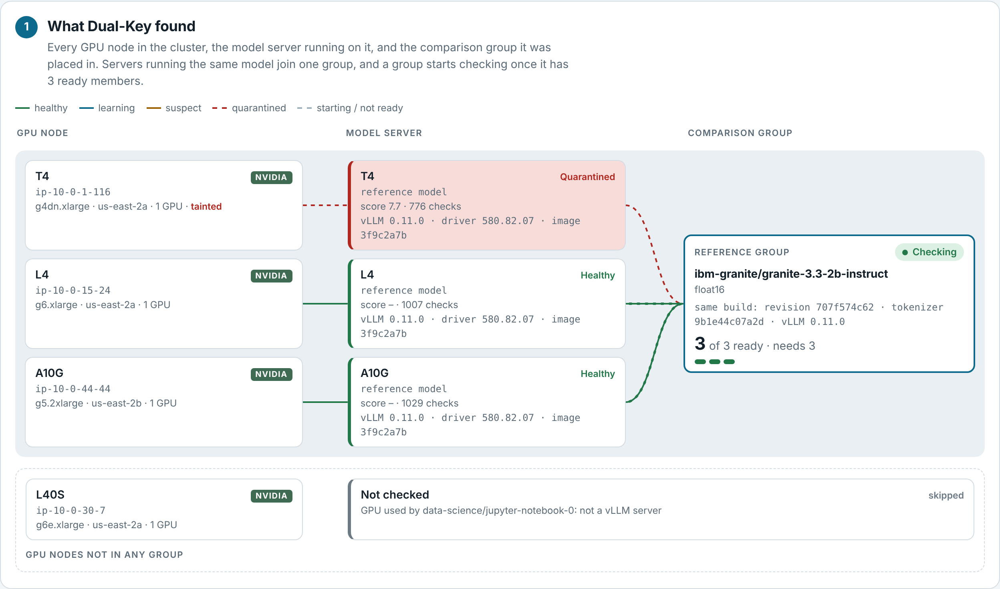
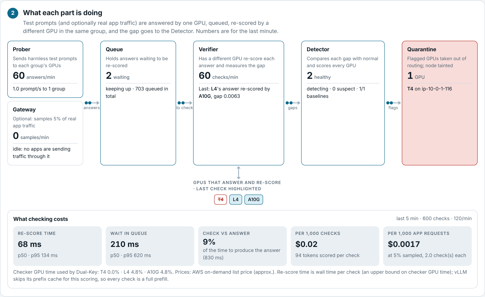
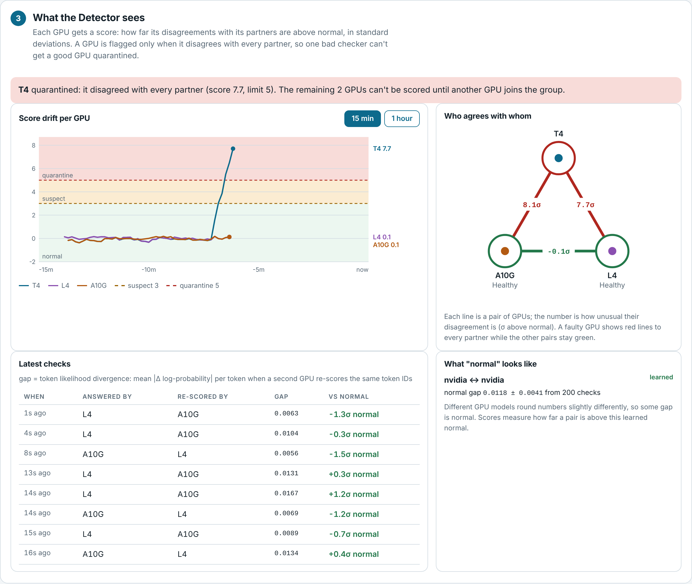
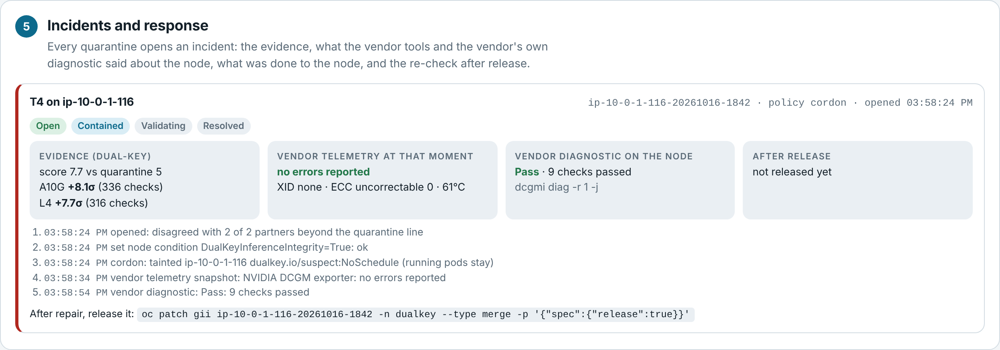

# Dual-Key

**Catch GPUs that give wrong AI answers without raising any error, and hand the finding to NVIDIA's and AMD's own repair tools.**

Dual-Key is a vendor-neutral inference-integrity layer for OpenShift. GPUs running the same model
re-score each other's answers; a GPU whose answers stop matching every peer is quarantined, with the
evidence, the vendor's telemetry and the vendor's own diagnostic attached, and its node is handed to
NVIDIA NVSentinel or the AMD GPU Operator for repair.


&nbsp;OpenShift 4.x · NVIDIA and AMD · Apache-2.0 · proof of concept (v0.3)

<p align="center">
  
</p>

> **Lab result (OpenShift 4.22 on AWS, NVIDIA T4 + L4 + A10G):** a T4 running a silently corrupted
> model scored **+9σ against both peers** while the L4–A10G pair stayed at 0σ. NVIDIA DCGM reported
> **no errors**, `dcgmi diag` **passed**, and NVSentinel **cordoned and drained the node 15 seconds
> after** Dual-Key's finding, with no change to NVIDIA's software.

---

## Why

Some GPU faults are silent: a weak memory cell, a marginal compute unit or a timing fault under heat
makes the GPU compute some results wrong while it keeps running. Nothing crashes and nothing is
logged; the model simply answers differently. Meta reports silent data corruption at roughly
**one fault per thousand devices** in its fleet.

The vendors' health tools (NVIDIA DCGM and NVSentinel, AMD GPU Operator) catch faults that announce
themselves: XID driver errors, ECC memory errors, overheating, crashes. They do that well. **Nothing
checks whether the answers are still right.** Dual-Key does, and feeds what it finds back into those
same tools.

What Dual-Key does **not** claim: that every disagreement is a hardware fault. It flags a GPU only
when it disagrees with **every** peer, **repeatedly**, while all peers run the **identical model build**,
and it records the evidence for a person to review.

## How it works

GPUs running the same model check each other's answers; the one that disagrees with all the others is
the faulty one. Because the model is the same file on every GPU, a difference that follows one GPU is
that GPU's hardware, not the model.

1. **One GPU answers** a test prompt and records how likely it found each token.
2. **A different GPU re-scores the same token IDs** (teacher forcing, one fast pass, no new answer).
3. **The gap** between the two sets of log-probabilities is the *token likelihood divergence*.
4. **Majority vote:** with at least 3 GPUs, the one whose gap is high against every partner is the outlier.

<p align="center"></p>

### The parts and where they run

Only the model servers use GPUs. Everything Dual-Key adds is a small ordinary container; the vendor
tools are read and signalled, never modified.

<p align="center"></p>

| Component | Job |
|---|---|
| **Operator** | Finds vLLM servers on GPUs, groups them by exact model build, deploys a reference model when needed, opens incidents, applies the response policy, runs vendor diagnostics |
| **Prober** | Sends test prompts to each group (about 1 per second), greedy and seeded |
| **Gateway** (optional) | Samples a share (5% by default) of real application traffic |
| **Queue** | Holds sampled answers waiting to be checked (Redis streams) |
| **Verifier** | Picks a different GPU (other vendor preferred, least-checked pair), has it re-score, records the gap, time and queue age |
| **Detector** | Learns the normal gap per vendor pair, scores each GPU, moves it Learning → Healthy → Suspect → Quarantined |
| **Dashboard** | Five live views (below) |

### Grouping: only identical builds are compared

Servers join one comparison group only if they share the model, revision, weights checksum (when
declared), precision, quantization, tensor-parallel size, **tokenizer** (fingerprinted with a canary
sentence) and **vLLM version**. Look-alike servers that differ are kept apart and the dashboard says
why. If a member's vLLM image, version or GPU driver changes, its evidence restarts, so a software
upgrade can never look like a failing GPU. If no group has 3 members, the operator deploys a small
reference model (Granite 3.3 2B, pinned to one commit) on free GPU nodes.

### Deciding: learned normal, smoothed score, majority

- The first 200 checks per vendor pairing (NVIDIA↔NVIDIA, NVIDIA↔AMD, AMD↔AMD) set the normal gap.
- Each later gap becomes "σ above normal"; each GPU pair keeps a smoothed average (about 40 checks).
- A GPU's score is its **lowest** pair value, so one bad checker cannot get a good GPU flagged.
- Suspect above 3σ, Quarantined above 5σ for 10 more checks (all configurable). Quarantine is sticky
  until a person releases it.

## Incident and response

Every quarantine opens a `GPUIntegrityIncident` holding the evidence, a snapshot of the vendor's
telemetry for the node, the result of the vendor's own diagnostic, every action taken, and the
re-check after release.

<p align="center"></p>

OpenShift schedules by node, so the response acts on the node (`spec.remediation.action`):

| Policy | Effect on the node |
|---|---|
| `alert` | Incident and node condition only |
| `cordon` | Taint `dualkey.io/suspect:NoSchedule`; running pods stay |
| `drain` | Cordon, then evict GPU pods through the Eviction API (respects PodDisruptionBudgets) |
| `evict` | Cordon, then delete GPU pods immediately |
| `handoff` | Set the node condition and let NVSentinel or the AMD GPU Operator do the node work |

After repair, `oc patch gii <name> -n dualkey --type merge -p '{"spec":{"release":true}}'` removes the
taint and condition; the GPU must agree with its partners again (about 20 checks per partner) before
the incident resolves. Under `handoff` the release happens automatically when the vendor reboots the node.

## Vendor integration

Dual-Key never fakes an error inside a vendor tool. It publishes its finding as a standard node
condition, `DualKeyInferenceIntegrity=True`, which each vendor's tooling acts on.

<p align="center"></p>

- **NVIDIA NVSentinel:** a Kubernetes Object Monitor policy ([`deploy/integrations/nvsentinel-values.yaml`](deploy/integrations/nvsentinel-values.yaml))
  turns the condition into a fatal GPU health event; NVSentinel cordons and drains the node, and
  uncordons it when Dual-Key clears the condition. `scripts/install-nvsentinel.sh` installs it on
  OpenShift (including the SELinux and permission settings OpenShift needs). **Tested end to end.**
- **AMD GPU Operator:** an auto-remediation mapping ([`deploy/integrations/amd-remediation-mapping.yaml`](deploy/integrations/amd-remediation-mapping.yaml))
  runs AMD's workflow (taint, drain, reboot, RVS validation, untaint). Follows AMD's documented
  mechanism; **not yet tested** on AMD hardware.

## Dashboard

| | |
|---|---|
|  | **1. What Dual-Key found.** GPU nodes → model servers → comparison groups, with each group's exact build. |
|  | **2. What each part is doing.** The pipeline with live counts, plus what checking costs. |
|  | **3. What the Detector sees.** Score drift per GPU, who agrees with whom, the learned normal, latest checks. |
|  | **4. Dual-Key vs the vendor's monitoring.** XID, ECC, retired rows, temperature, power next to Dual-Key's verdict. |
|  | **5. Incidents and response.** Evidence, vendor telemetry, vendor diagnostic, actions, re-check. |

Try it without a cluster: `uvicorn dualkey.ui:app --port 8080`, then open `http://localhost:8080/?demo=1`.

## Results

| Injected fault on the T4 (lab) | T4 score | Outcome |
|---|---|---|
| 20,000 weights × 2 (0.1% of one layer) | 0.18σ | Seen, not flagged |
| 1,000,000 weights × 2 (6% of one layer) | 1.6σ | Seen, not flagged |
| 1,000,000 weights × 16 | +9σ vs both peers | Quarantined; DCGM no errors; `dcgmi diag` pass; NVSentinel cordoned and drained the node in 15 s |

**Overhead (measured live):** re-score 30 ms p50 / 35 ms p95 per check, about 5% of the time to
produce the answer; under 1% of each checker GPU's time at one probe per second.

The lab fault corrupts the model weights before loading, reproducing the *effect* of a faulty GPU on
healthy hardware. It demonstrates the class of fault Dual-Key catches; it does not show that DCGM
misses real hardware faults, because in the lab there is nothing for DCGM to see.

## Quick start (OpenShift on AWS)

```bash
oc login https://api.<cluster>:6443
./scripts/setup-aws-gpus.sh              # GPU nodes (T4, A10G, L4), NFD, GPU Operator, Dual-Key
# or, on a cluster that already has GPUs:
oc apply -k deploy/
oc start-build dualkey -n dualkey --from-dir=. --follow
oc apply -f deploy/samples/dualkeycluster-aws.yaml
echo https://$(oc get route dualkey-dashboard -n dualkey -o jsonpath='{.spec.host}')
```

Hand findings to NVIDIA NVSentinel, then run the full loop:

```bash
bash scripts/install-nvsentinel.sh       # installs NVSentinel, switches Dual-Key to handoff
BIT=9 COUNT=1000000 bash scripts/fault.sh   # corrupt the T4's model copy and watch it get caught
bash scripts/install-nvsentinel.sh status   # node cordoned by NVSentinel
bash scripts/fault.sh undo                  # clean model, release, NVSentinel uncordons, re-check
```

More: [docs/design.md](docs/design.md) (design overview) · [docs/lab-guide.md](docs/lab-guide.md) (lab walkthrough and troubleshooting).

## Configuration highlights

| Setting | Default | Meaning |
|---|---|---|
| `mode` | `discover` | `discover` finds running models; `manual` uses `spec.gpus` |
| `discovery.minMembers` | 3 | Ready members a group needs |
| `reference.enabled` | true | Deploy the reference model when no group can form |
| `probe.rate` | 1.0 | Test prompts per second per group |
| `detector.suspectZ` / `quarantineZ` / `confirmChecks` | 3 / 5 / 10 | Sensitivity |
| `detector.stdFloor` | 0.01 | Minimum spread of the normal gap; lower = more sensitive |
| `remediation.action` | alert (discover) / cordon (manual) | Response policy |
| `cost.gpuHourUSD` | AWS list prices | Price per GPU-hour for the cost panel |

## Limits and next steps

- Only vLLM servers are recognised; TGI, Triton and NIM are listed as skipped.
- Tested on NVIDIA only (AWS offers no AMD Instinct GPUs); the AMD paths follow AMD's documentation.
- With exactly 3 GPUs, once one is quarantined the other two cannot be scored until a fourth joins.
- GPUs are identified by node and deployment, not by serial number.
- **Next:** AMD Instinct peers (AMD answers checked by NVIDIA and the reverse); *golden replay* for
  models on fewer than 3 GPUs; a published overhead benchmark; OLM bundle.

## Repository layout

```
dualkey/            the operator and checking pipeline (Python)
  operator.py       discovery, grouping, reference fallback, incidents, response, diagnostics
  discovery.py      vLLM server discovery and exact-build identity
  verifier.py       checker choice, re-scoring, gap, timing
  detector.py       baselines, scores, states;  scoring.py  the scoring logic
  remediation.py    incident evidence, response policy, diagnostic parsing, validation
  vendor.py         DCGM / AMD exporter telemetry and node conditions
  overhead.py       latency and cost of checking
  ui.py, static/    the dashboard
deploy/             CRDs, RBAC, operator, samples, integrations/ (NVSentinel, AMD)
scripts/            setup-aws-gpus.sh, install-nvsentinel.sh, fault.sh
tests/              unit tests, end-to-end simulations, incident flow against fake APIs
docs/               design overview, lab guide, images
```

## Develop

```bash
pip install -r requirements-dev.txt
pytest -q
```

## License

Apache License 2.0. See [LICENSE](LICENSE).

Built by [Puneet Marhatha](https://github.com/redhatterPuneet). Dual-Key is an independent proof of
concept, not a product of Red Hat, NVIDIA or AMD.
