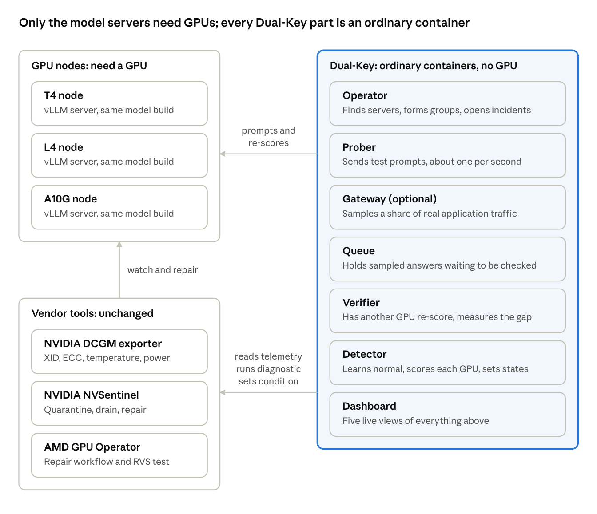
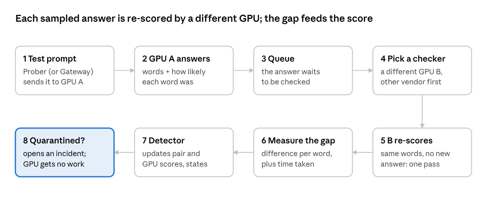
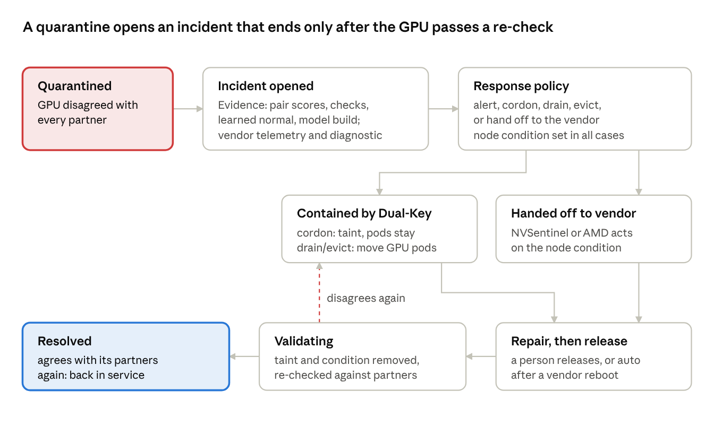
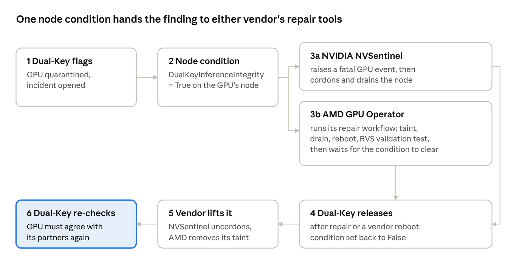

# Dual-Key: Design Overview (v0.3)

Dual-Key catches GPUs that give wrong AI answers without raising any error, and hands that finding to
the GPU vendor's own repair tools. It runs on OpenShift, works with NVIDIA and AMD GPUs, and needs no
change to the vendors' software.

## 1. The problem

**Silent data corruption.** Sometimes a GPU keeps running but computes some results wrong: a weak
memory cell, a marginal compute unit, a timing fault under heat. Nothing crashes and nothing is logged;
the model gives slightly different, sometimes wrong, answers. Meta reports such faults at roughly one
per thousand devices across its fleet.

**Why the vendors' tools miss it.** NVIDIA's DCGM and NVSentinel and AMD's GPU Operator watch for
faults that announce themselves: XID driver errors, ECC memory errors, overheating, crashes. A silent
fault announces nothing, and no tool checks whether the answers are still right.

**What Dual-Key does not claim.** Not every disagreement is a hardware fault. Dual-Key flags a GPU
only when it disagrees with every peer, repeatedly, while all of them run the identical model build,
and records the evidence for a person to review.

## 2. The core idea

GPUs running the same model check each other's answers; the one that disagrees with all the others is
the faulty one.

1. **Same model, several GPUs.** At least three GPUs run the exact same model build, possibly of
   different types (NVIDIA and AMD).
2. **One GPU answers** a test prompt (or a sample of real traffic) and records how likely the model
   found each token.
3. **Another GPU re-scores the same answer.** It is given the exact token IDs and asked how likely it
   finds each one. One fast pass, no new answer.
4. **Measure the gap** (token likelihood divergence): the mean absolute difference in log-probability
   per token. Healthy GPUs differ a little because they round numbers differently; a faulty GPU differs
   a lot.
5. **Majority vote.** If A disagrees with B and with C while B and C agree, A is the problem. With only
   two GPUs you can see a disagreement but not who is wrong, so three is the minimum.

**Why this points at the GPU and not the model:** the model is the same file on every GPU. Normal
answers on two GPUs and unusual answers on a third means the difference comes from the third GPU.

## 3. The parts and where they run

Only the model servers use GPUs. Everything Dual-Key adds runs as small ordinary containers in one
namespace; the vendors' tools are read and signalled but never changed.

## 4. Step 1: find the GPUs and group them

Every 30 seconds the operator:

1. **Scans** every pod that uses an NVIDIA or AMD GPU. vLLM servers become candidates; other GPU pods
   are shown as "not checked" with the reason.
2. **Identifies the model** from labels, start-up arguments, or by asking the server.
3. **Confirms the exact build:** vLLM version (`/version`), tokenizer fingerprint (`/tokenize` on a
   fixed canary sentence), container image digest, GPU driver on the node.
4. **Groups** servers only if model, revision, weights checksum (when declared), precision,
   quantization, tensor-parallel size, tokenizer and vLLM version all match. Look-alikes that differ are
   kept apart with the reason.
5. **Starts checking** once a group has 3 ready members.
6. **Falls back** to a small reference model (Granite 3.3 2B, pinned to one commit) on free GPU nodes
   when no group has 3 members.

A change to a member's vLLM image, version or GPU driver restarts its evidence, so an upgrade never
looks like a failing GPU. A cluster running several models gets one group per model; a GPU serving two
models takes part in two groups.

## 5. Step 2: the checking flow

- **Who answers (1):** the Prober rotates through the group's GPUs, skipping quarantined ones. The
  optional Gateway does the same with a 5% sample of real traffic. Probes are greedy with a fixed seed.
- **Who checks (4):** never the GPU that answered, never a quarantined one; another vendor about 70%
  of the time; the least-checked pair, so every pair builds evidence.
- **What is recorded (6):** the gap, both GPU names, the re-score time and the queue wait (these also
  feed the cost panel).
- **What changes (7, 8):** states are shared with the Prober, Gateway and Verifier, so a quarantined
  GPU stops answering and checking at once.

## 6. Step 3: how the Detector decides

1. **Learn normal.** The first 200 checks per vendor pairing set the normal gap and its spread (with a
   configurable minimum spread, `stdFloor`, 0.01 by default). In the lab the normal gap was about 0.0009.
2. **Score each check** as σ above normal.
3. **Smooth per pair** (exponential average, about the last 40 checks).
4. **Score each GPU** as its lowest pair value: high only if every partner disagrees.
5. **States:** Learning → Healthy → Suspect (above 3) → Quarantined (above 5 for 10 more checks).

Worked example from the lab: the T4 ran a corrupted copy of the model. Its pairs with the L4 and A10G
rose to about +9σ while the L4–A10G pair stayed near 0; the T4 was quarantined, DCGM reported no errors,
and NVSentinel cordoned and drained its node 15 seconds later.

Sensitivity is a setting: lower thresholds (or a lower `stdFloor`) catch smaller faults sooner but risk
flagging healthy GPUs.

## 7. Step 4: incident and response

Every quarantine opens a `GPUIntegrityIncident`:

- **Evidence:** each partner's score and number of checks, recent checks, the learned normal, model
  build and software versions.
- **Vendor view:** a telemetry snapshot for the node (XID, ECC, temperature, power) and the result of
  the vendor's own diagnostic run on that node (`dcgmi diag -r 1`, `amd-smi`).
- **Response on the node** by policy: `alert`, `cordon`, `drain`, `evict` or `handoff`.
- **Release and re-check:** after repair, releasing the incident removes the taint and condition; the
  GPU must agree with its partners for about 20 checks per partner before the incident resolves. If it
  disagrees again it is contained again; if too few checks arrive in 30 minutes it is marked timed out.

## 8. Vendor integration

Dual-Key never fakes an error inside a vendor tool. It publishes its finding as the node condition
`DualKeyInferenceIntegrity=True`:

- **NVIDIA NVSentinel** (tested): a Kubernetes Object Monitor policy turns the condition into a fatal
  GPU health event; NVSentinel cordons and drains the node and uncordons it when the condition clears.
- **AMD GPU Operator** (documented mechanism, untested): an auto-remediation mapping runs AMD's
  workflow: taint, drain, reboot, RVS validation, wait for the condition to clear, untaint.

## 9. Cost, dashboard, results, limits

- **Cost** is measured from real checks: re-score time, queue wait, share of each GPU's time, cost per
  1,000 checks and per 1,000 app requests. Live lab numbers: 30 ms p50 per check, about 5% of the time
  to produce the answer, under 1% of each checker GPU.
- **Dashboard:** what was found, what each part is doing (with cost), what the Detector sees, Dual-Key
  vs the vendor's monitoring, incidents and response.
- **Limits:** vLLM only; NVIDIA-tested only; with exactly 3 GPUs the remaining two cannot be scored
  after one is quarantined; GPUs identified by node, not serial number.
- **Next:** AMD Instinct peers, golden replay for models on fewer than 3 GPUs, published overhead
  benchmark.
